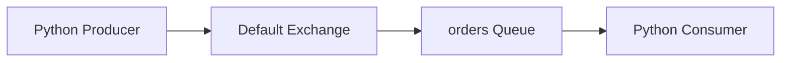

# Order Processing Queue

A learning-oriented asynchronous order processing project built with **Python**, **RabbitMQ**, and **Docker**.

This repository is part of a personal development plan (PDI) focused on progressing from introductory familiarity with messaging tools to a basic, practical understanding of RabbitMQ.

## Project goals

- Understand producers, consumers, queues, exchanges, and routing keys.
- Publish and consume fictional orders using Python.
- Explore routing across multiple queues.
- Learn acknowledgements, retries, message durability, and dead-letter queues.
- Document and run the application locally.

## Current progress

**Stage 2 — Basic message flow: implemented and manually validated.** A producer publishes a JSON order to the `orders` queue and a consumer receives and displays it. The flow was also tested with the consumer temporarily stopped.

**Planned:** Stage 3 (exchanges and routing), Stage 4 (reliability and failures), and Stage 5 (reprocessing, containerization of the application, and final documentation).

> The current example uses automatic consumer acknowledgements (`auto_ack=True`). It is intended for learning and is not production-ready. Queue durability does not by itself guarantee message persistence.

## Basic architecture



## Requirements

- Python 3.10+ (or a compatible Python version for the installed Pika release)
- Docker and Docker Compose
- Pika (`pip install -r requirements.txt`)

## Quick start

1. Start RabbitMQ:

   ```bash
   docker compose up -d
   ```

2. Install Python dependencies from the repository root:

   ```bash
   pip install -r requirements.txt
   ```

3. Run the consumer in one terminal:

   ```bash
   python -m src.consumers.order_consumer
   ```

4. Run the producer in another terminal:

   ```bash
   python -m src.producer.producer
   ```

5. Check that the consumer prints the received order.

The RabbitMQ management UI is available at [http://localhost:15672](http://localhost:15672). For the local tutorial configuration, the default credentials may be `guest` / `guest`; do not use these credentials in a deployed environment.

**Note:** The producer and consumer currently connect to `localhost`, so the Python commands above should run on the host machine while RabbitMQ runs in Docker.

## Manual validation

- Run the producer several times while the consumer is active and observe each message.
- Stop the consumer, publish messages, and inspect the `orders` queue in the management UI.
- Restart the consumer and verify that the queued messages are delivered.

The example currently publishes the same fictional order ID each time; this is intentional for the initial exercise.

## Documentation

- [`docs/fundamentals.md`](docs/fundamentals.md) — messaging and RabbitMQ fundamentals.
- [`docs/architecture.md`](docs/architecture.md) — project architecture (to be developed).
- [`docs/execution.md`](docs/execution.md) — detailed execution notes (to be developed).
- [`CONTRIBUTING.md`](CONTRIBUTING.md) — contribution guidance.
- [`CODE_OF_CONDUCT.md`](CODE_OF_CONDUCT.md) — community expectations.
- [`SECURITY.md`](SECURITY.md) — security reporting guidance.

## Development roadmap

- [x] Stage 1: Study RabbitMQ fundamentals and prepare the environment.
- [x] Stage 2: Implement and manually validate the basic producer → queue → consumer flow.
- [ ] Stage 3: Add exchanges, multiple queues, and routing keys.
- [ ] Stage 4: Explore ACK/NACK, retries, persistence, and dead-letter queues.
- [ ] Stage 5: Validate reprocessing, containerize the application, and complete documentation.

## License

See [`LICENSE`](LICENSE). The copyright holder and year must be reviewed before publishing.
