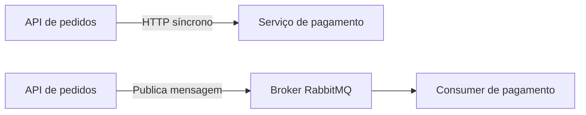
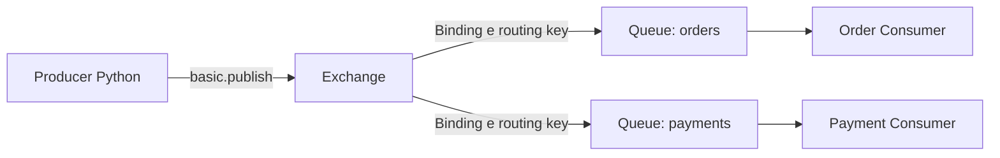
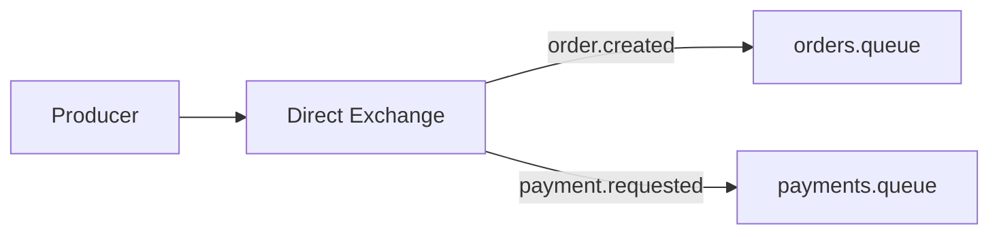
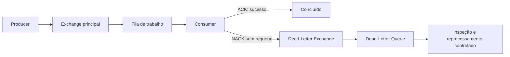
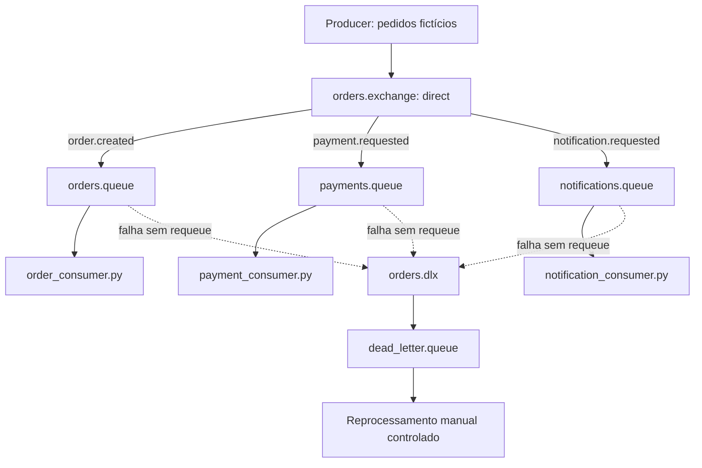

# RabbitMQ — Fundamentos de Mensageria

> **Projeto:** Order Processing Queue  
> **PDI:** Hard Skills 3 — Ferramentas de Mensageria  
> **Objetivo:** consolidar os fundamentos necessários para projetar, implementar e operar um fluxo assíncrono de pedidos fictícios com Python, RabbitMQ e Docker.

## Sumário

1. [Fundamentos de mensageria](#1-fundamentos-de-mensageria)
2. [Introdução ao RabbitMQ](#2-introdução-ao-rabbitmq)
3. [Componentes e estruturas](#3-componentes-e-estruturas)
4. [Exchanges e roteamento](#4-exchanges-e-roteamento)
5. [Producer e Consumer](#5-producer-e-consumer)
6. [Confiabilidade e falhas](#6-confiabilidade-e-falhas)
7. [Boas práticas e arquitetura](#7-boas-práticas-e-arquitetura)
8. [Aplicação no projeto](#8-aplicação-no-projeto)
9. [Glossário](#glossário)
10. [Referências](#referências)

---

## 1. Fundamentos de mensageria

### 1.1 O que é mensageria?

**Mensageria** é uma forma de comunicação entre componentes de software por meio de mensagens. Em vez de uma aplicação invocar diretamente todas as outras para executar uma tarefa, ela pode publicar uma mensagem para que outro componente a processe. Um **message broker** pode intermediar essa troca.

Exemplo: um serviço recebe um pedido e publica `order.created`. Um trabalhador independente recebe essa informação e inicia o processamento do pedido.

### 1.2 Comunicação síncrona e assíncrona

| Critério | Síncrona | Assíncrona |
|---|---|---|
| Interação | Em geral, o solicitante aguarda uma resposta | O solicitante pode continuar após publicar a mensagem |
| Acoplamento temporal | Os serviços precisam estar disponíveis ao mesmo tempo | O consumidor pode processar depois, desde que a mensagem permaneça disponível |
| Exemplo | Requisição HTTP esperando resposta | Publicação em uma fila RabbitMQ |
| Desafio | Latência, timeout e disponibilidade do serviço chamado | Consistência eventual, duplicatas e monitoramento de filas |

**Importante:** assíncrono não significa necessariamente mais rápido. Ele permite desacoplar etapas e absorver variações de carga, mas adiciona complexidade operacional.



### 1.3 Message Broker

Um **broker de mensagens** recebe mensagens de produtores, aplica regras de roteamento e as encaminha para filas ou outros destinos. No RabbitMQ, o produtor normalmente publica em uma **exchange**, que decide para quais filas encaminhar a mensagem.

Responsabilidades típicas:

- Receber publicações e encaminhá-las segundo bindings e routing keys.
- Manter mensagens em filas até sua entrega, sujeitas à configuração de durabilidade, limites e políticas.
- Entregar mensagens a consumidores e acompanhar confirmações de processamento.
- Expor métricas, conexões e estados das filas para operação.

### 1.4 Producer, Consumer, mensagem e evento

- **Producer:** aplicação que publica mensagens, por exemplo `producer.py`.
- **Consumer:** aplicação que recebe e processa mensagens, por exemplo `order_consumer.py`.
- **Mensagem:** unidade transportada, com corpo (payload), propriedades e metadados.
- **Evento:** representação de algo que aconteceu, como `order.created`. Um evento pode ser transportado como mensagem; nem toda mensagem representa um evento (pode ser um comando, por exemplo `payment.process`).

**Exemplo de evento:**

```json
{
  "event_id": "evt-001",
  "event_type": "order.created",
  "occurred_at": "2026-10-15T15:00:00Z",
  "order_id": "ord-1001",
  "customer_id": "cust-42",
  "amount": 149.90,
  "currency": "BRL"
}
```

### 1.5 Desacoplamento

O Producer não precisa conhecer o processo interno do Consumer. Ele precisa respeitar um **contrato de mensagem**. Esse desacoplamento permite escalar e atualizar componentes de forma independente, mas exige versionamento de contratos, tratamento de erros e observabilidade.

**No projeto:** a criação de pedidos não dependerá de o Consumer de pagamento estar disponível no instante da publicação.

---

## 2. Introdução ao RabbitMQ

### 2.1 O que é RabbitMQ?

**RabbitMQ** é um message broker que suporta protocolos de mensageria, incluindo **AMQP 0-9-1**. Ele recebe mensagens de aplicações, roteia-as por exchanges e as disponibiliza em filas para consumo.

É adequado para tarefas assíncronas, integração de serviços, distribuição de trabalho e processamento orientado a eventos. Não deve ser confundido com um banco de dados de propósito geral.

### 2.2 Arquitetura conceitual



O fluxo típico é:

1. O Producer abre uma conexão TCP e um channel AMQP.
2. Publica uma mensagem em uma exchange, informando uma routing key.
3. A exchange avalia seus bindings e encaminha a mensagem às filas correspondentes.
4. O broker entrega a mensagem a um Consumer inscrito na fila.
5. O Consumer processa e envia uma confirmação (`ACK`) ou uma negativa (`NACK`/`Reject`), conforme o resultado.

**Atenção:** uma mensagem sem rota pode ser descartada ou devolvida ao Producer, dependendo da configuração de publicação e da exchange. A existência de uma exchange não garante que uma fila receberá a mensagem.

### 2.3 Protocolo AMQP 0-9-1

**AMQP (Advanced Message Queuing Protocol)** define operações de mensageria, como publicação, consumo, declaração de filas, exchanges e confirmações. O RabbitMQ utiliza AMQP 0-9-1 amplamente com clientes Python como **Pika**.

Operações comuns:

| Operação | Finalidade |
|---|---|
| `exchange_declare` | Declara uma exchange |
| `queue_declare` | Declara uma fila |
| `queue_bind` | Associa fila a exchange com regras de roteamento |
| `basic_publish` | Publica mensagem |
| `basic_consume` | Registra consumidor |
| `basic_ack` | Confirma entrega processada |
| `basic_nack` | Nega entrega, opcionalmente solicitando requeue |
| `basic_qos` | Controla entregas não confirmadas por consumidor/canal, conforme semântica do broker |

**AMQP 0-9-1 não é o mesmo protocolo que AMQP 1.0.**

### 2.4 Broker, nó e cluster

- **Broker:** serviço RabbitMQ que recebe, roteia e entrega mensagens.
- **Node:** instância RabbitMQ em execução.
- **Cluster:** conjunto de nós RabbitMQ trabalhando em conjunto; alta disponibilidade depende também do tipo de fila e da configuração.
- **Management UI:** interface administrativa opcional para inspecionar filas, exchanges, conexões e métricas.

### 2.5 Casos de uso e limitações

**Casos de uso:** processamento de pedidos, envio de notificações, execução de tarefas em background, integração entre sistemas e distribuição de trabalho.

**Cuidados:** filas podem crescer quando consumidores não acompanham a produção; mensagens podem ser redeliveradas; e a disponibilidade depende da configuração e operação do broker.

---

## 3. Componentes e estruturas

### 3.1 Connection

Conexão TCP estabelecida entre a aplicação e o RabbitMQ. É relativamente custosa e normalmente deve ser reutilizada, em vez de criar uma nova conexão por mensagem.

### 3.2 Channel

Canal lógico multiplexado sobre uma conexão AMQP. Permite publicar, consumir e declarar recursos. Channels normalmente não devem ser compartilhados sem controle entre threads; consulte as restrições do cliente utilizado.

### 3.3 Exchange

Ponto de entrada para publicações. Decide para quais filas a mensagem será roteada, conforme o **tipo da exchange** e os **bindings** existentes. Exchanges não são, por padrão, o local onde mensagens ficam aguardando consumo.

### 3.4 Queue

Fila que mantém mensagens prontas ou aguardando confirmação, de acordo com seu estado. Consumidores recebem entregas de uma fila. Uma fila com vários consumidores normalmente distribui entregas entre eles (competing consumers), não faz broadcast para todos.

### 3.5 Binding

Associação entre uma exchange e uma fila (ou, em alguns cenários, outra exchange), com uma regra de roteamento. O significado da binding key depende do tipo de exchange.

### 3.6 Routing Key

Texto informado pelo Producer na publicação. Exchanges como `direct` e `topic` usam essa chave para decidir o destino.

Exemplo: `order.created`, `payment.approved`, `notification.email`.

### 3.7 Virtual Host (vhost)

Espaço lógico de isolamento de recursos e permissões dentro do RabbitMQ. Exchanges, filas e bindings são definidos em um vhost. Aplicações de ambientes diferentes podem usar vhosts separados.

### 3.8 Message

Uma mensagem AMQP possui:

- **Body:** bytes do conteúdo, frequentemente JSON codificado em UTF-8.
- **Properties:** metadados como `content_type`, `delivery_mode`, `message_id`, `correlation_id` e headers.
- **Routing key:** parâmetro da publicação usado pelo roteamento.

Exemplo de propriedades com Pika:

```python
import pika

properties = pika.BasicProperties(
    content_type="application/json",
    delivery_mode=2,  # solicitação de mensagem persistente
    message_id="evt-001",
    correlation_id="ord-1001",
)
```

### 3.9 Resumo das relações

| Elemento | Papel | Exemplo do projeto |
|---|---|---|
| Connection | Comunicação com broker | Conexão do Producer |
| Channel | Sessão lógica AMQP | Canal de publicação |
| Exchange | Roteamento | `orders.exchange` |
| Queue | Armazenamento/entrega | `orders.queue` |
| Binding | Regra exchange → fila | `order.created` |
| Routing Key | Chave de publicação | `order.created` |
| Vhost | Isolamento lógico | `/order-processing` |
| Message | Dados e metadados | JSON do pedido |

---

## 4. Exchanges e roteamento

### 4.1 Direct Exchange

Entrega a mensagem às filas cujas binding keys correspondem **exatamente** à routing key publicada.

Exemplo: `order.created` → `orders.queue`; `payment.requested` → `payments.queue`.



**Uso:** roteamento explícito por tipo de tarefa.

### 4.2 Fanout Exchange

Encaminha cada mensagem para **todas as filas vinculadas** à exchange, ignorando a routing key para decidir o destino.

**Uso:** publicar o mesmo evento para diferentes serviços, como auditoria e notificações, cada um com sua fila.

### 4.3 Topic Exchange

Compara routing keys formadas por palavras separadas por pontos (`.`) com padrões de binding:

- `*` corresponde a **exatamente uma** palavra.
- `#` corresponde a **zero ou mais** palavras.

| Binding key | Corresponde a | Não corresponde a |
|---|---|---|
| `order.*` | `order.created` | `order.payment.approved` |
| `order.#` | `order.created`, `order.payment.approved`, `order` | `payment.created` |
| `*.created` | `order.created` | `order.payment.created` |

**Uso:** assinatura flexível de famílias de eventos.

### 4.4 Headers Exchange

Usa valores de headers da mensagem em vez da routing key para determinar o roteamento. Pode combinar condições com `x-match=all` ou `x-match=any`.

**Uso:** roteamento por atributos como canal, prioridade ou região quando esses critérios não se encaixam bem em routing keys.

### 4.5 Comparativo

| Tipo | Critério de roteamento | Exemplo |
|---|---|---|
| Direct | Correspondência exata | `payment.requested` |
| Fanout | Todas as filas vinculadas | Aviso para auditoria e notificações |
| Topic | Padrões com `*` e `#` | `order.*` |
| Headers | Atributos nos headers | `region=br`, `priority=high` |

### 4.6 Exchange padrão

O RabbitMQ possui uma **default exchange** (nome vazio, `""`), do tipo direct. Filas declaradas são automaticamente vinculadas a ela usando o próprio nome como routing key. Isso permite o primeiro fluxo Producer → Queue → Consumer sem declarar uma exchange personalizada.

```python
channel.basic_publish(
    exchange="",
    routing_key="orders.queue",
    body=b'{"order_id":"ord-1001"}',
)
```

### 4.7 Escolha para o projeto

Começaremos com a **default exchange** na Tarefa 2. Na Tarefa 3, criaremos uma **direct exchange** com bindings explícitos. Uma topic exchange poderá ser explorada como exercício complementar, sem necessidade de introduzir todos os tipos na aplicação final.

---

## 5. Producer e Consumer

### 5.1 Publicação de mensagens

O Producer cria uma estrutura de dados, serializa em bytes e chama `basic_publish`. O RabbitMQ não transforma automaticamente um dicionário Python em JSON.

```python
import json
import pika

connection = pika.BlockingConnection(
    pika.ConnectionParameters(host="localhost")
)
channel = connection.channel()
channel.queue_declare(queue="orders.queue", durable=True)

order = {"order_id": "ord-1001", "status": "created", "amount": 149.90}
body = json.dumps(order).encode("utf-8")

channel.basic_publish(
    exchange="",
    routing_key="orders.queue",
    body=body,
    properties=pika.BasicProperties(
        content_type="application/json",
        delivery_mode=2,
        message_id="evt-001",
    ),
)
connection.close()
```

**Observação:** este exemplo é didático. Em um fluxo confiável, também configuraremos Publisher Confirms e tratamento de publicações não roteadas.

### 5.2 Consumo e desserialização

```python
import json
import pika

connection = pika.BlockingConnection(
    pika.ConnectionParameters(host="localhost")
)
channel = connection.channel()
channel.queue_declare(queue="orders.queue", durable=True)
channel.basic_qos(prefetch_count=1)

def on_message(ch, method, properties, body):
    try:
        order = json.loads(body.decode("utf-8"))
        print(f"Processando pedido: {order['order_id']}")
        # Aqui entraria a lógica real de processamento.
        ch.basic_ack(delivery_tag=method.delivery_tag)
    except Exception as exc:
        print(f"Falha ao processar mensagem: {exc}")
        # Exemplo didático: não reenfileirar indefinidamente.
        ch.basic_nack(delivery_tag=method.delivery_tag, requeue=False)

channel.basic_consume(
    queue="orders.queue",
    on_message_callback=on_message,
    auto_ack=False,
)
channel.start_consuming()
```

**Importante:** `requeue=False` descarta a mensagem se não houver configuração de dead-lettering. Na Tarefa 4, configuraremos DLX/DLQ para capturar falhas.

### 5.3 Entrega e confirmação

Com `auto_ack=False`, uma entrega permanece **unacked** até o Consumer confirmar ou negar. Se a conexão ou o channel cair antes do ACK, a mensagem não confirmada normalmente volta a ficar disponível para entrega, podendo ser processada mais de uma vez.

### 5.4 Prefetch

`basic_qos(prefetch_count=N)` limita a quantidade de entregas não confirmadas que o broker envia, segundo a semântica de QoS do RabbitMQ. `prefetch_count=1` é útil em demonstrações de distribuição de trabalho, mas não é universalmente o melhor valor de performance.

### 5.5 Múltiplos consumidores

- **Vários Consumers na mesma fila:** competem pelas mensagens; cada entrega vai a um deles por vez, embora redeliveries possam ocorrer.
- **Várias filas vinculadas à exchange:** uma publicação pode gerar cópias para cada fila correspondente, permitindo que serviços distintos processem o mesmo evento.

### 5.6 Contrato e versionamento de mensagens

Defina campos obrigatórios, tipos e uma versão de schema. Considere `event_id`, `event_type`, `schema_version`, `occurred_at` e `order_id`. Valide mensagens na entrada do Consumer e evite mudanças incompatíveis sem migração.

---

## 6. Confiabilidade e falhas

### 6.1 ACK, NACK e Reject

| Mecanismo | O que faz | Uso comum |
|---|---|---|
| `basic_ack` | Confirma que a entrega pode ser removida da fila | Processamento concluído |
| `basic_nack` | Nega uma ou várias entregas; permite definir `requeue` | Falha de processamento |
| `basic_reject` | Nega uma entrega específica; permite `requeue` | Rejeição individual |

**ACK do Consumer não confirma ao Producer que a publicação foi recebida.** Para isso, utiliza-se **Publisher Confirms**.

### 6.2 Requeue e retry

- **Requeue:** recoloca a mensagem para nova entrega (por exemplo, `basic_nack(..., requeue=True)`).
- **Retry:** estratégia de novas tentativas, preferencialmente com limite, espera e classificação de erros.

Requeue imediato sem controle pode gerar **loop infinito** e alto consumo de CPU. Uma estratégia comum utiliza fila de retry com TTL e dead-lettering de volta para a fila de trabalho, ou outro mecanismo explícito de agendamento. É necessário controlar o número de tentativas na aplicação ou via mecanismo apropriado ao tipo de fila.

### 6.3 Dead-Letter Exchange (DLX) e Dead-Letter Queue (DLQ)

- **DLX:** exchange para a qual o RabbitMQ republica mensagens que sofreram determinadas condições de dead-lettering.
- **DLQ:** fila vinculada à DLX que recebe essas mensagens para inspeção, tratamento ou reprocessamento.

Condições possíveis incluem rejeição com `requeue=False`, expiração por TTL, limite de tamanho da fila e limites de entrega em filas quorum, conforme configuração.



### 6.4 Persistência e durabilidade

**São propriedades distintas:**

- **Fila durável (`durable=True`):** a definição da fila sobrevive à reinicialização do broker.
- **Mensagem persistente (`delivery_mode=2`):** solicita persistência da mensagem no broker.
- **Exchange durável:** sua definição sobrevive à reinicialização.

Combinar fila durável e mensagens persistentes é importante, mas **não garante, sozinho, ausência de perda em qualquer falha**. Considere Publisher Confirms, configuração do tipo de fila, replicação quando necessária e limites operacionais.

### 6.5 Publisher Confirms

Publisher Confirms permitem ao Producer saber se o broker confirmou o processamento da publicação. Para detectar mensagens sem rota, considere também `mandatory=True` e o tratamento de retornos/publicações não roteadas. Confirmação do broker não significa que um Consumer já processou a mensagem.

### 6.6 Semântica de entrega

- **At-most-once:** pode perder mensagens, mas não tenta redeliver após falha.
- **At-least-once:** pode redeliver, portanto pode haver duplicatas; é o padrão de projeto mais comum com ACK manual e recuperação.
- **Exactly-once:** não deve ser assumido como garantia fim a fim do RabbitMQ. Exige controles adicionais e semântica de negócio apropriada.

### 6.7 Reprocessamento seguro

Antes de republicar uma mensagem da DLQ, investigue a causa da falha. Preserve identificadores, rastreie tentativas, evite duplicações de efeitos colaterais e limite reprocessamentos. Uma mensagem inválida não será corrigida apenas por novas tentativas.

---

## 7. Boas práticas e arquitetura

### 7.1 Idempotência

Uma operação é **idempotente** quando executá-la novamente não altera o resultado além da primeira execução bem-sucedida. Como mensagens podem ser redeliveradas, Consumers devem evitar cobrar ou criar o mesmo pedido duas vezes.

Exemplo: verificar se `event_id` já foi processado antes de aplicar um efeito de negócio. Em produção, essa verificação precisa ser confiável e, quando necessário, transacional com a alteração de estado.

### 7.2 Duplicidade e ordenação

Não assuma que uma fila com múltiplos Consumers, retries e redeliveries preservará a ordem de **conclusão** do processamento. Se a ordem por pedido importar, projete mecanismos específicos (particionamento lógico, serialização por chave, versionamento ou controle de estado).

### 7.3 Escalabilidade e backpressure

- Ajuste número de Consumers e `prefetch` conforme a carga.
- Monitore a quantidade de mensagens **ready** e **unacked**.
- Evite que produtores gerem volume sem considerar a capacidade de consumo.
- Planeje limites, alertas e comportamento em caso de indisponibilidade.

### 7.4 Observabilidade

Registre, preferencialmente de forma estruturada:

- `message_id`, `order_id`, `correlation_id` e tipo do evento.
- Data/hora de publicação, início e fim do processamento.
- Resultado, duração, motivo da falha e número de tentativas.

Métricas úteis: taxa de publicação e consumo, tamanho das filas, mensagens não confirmadas, redeliveries, mensagens na DLQ e conexões abertas.

### 7.5 Segurança

- Não exponha credenciais no código ou no GitHub; use variáveis de ambiente.
- Use usuários e permissões mínimos por vhost.
- Em produção, configure TLS, rede restrita e autenticação apropriada.
- Evite registrar dados pessoais ou sensíveis em logs e payloads sem necessidade.
- Não exponha o painel de administração publicamente sem proteção.

### 7.6 Tratamento de falhas

Classifique falhas antes de decidir o destino da mensagem:

| Falha | Exemplo | Tratamento típico |
|---|---|---|
| Transitória | Serviço externo indisponível | Retry com limite e intervalo |
| Permanente | JSON inválido ou campo obrigatório ausente | DLQ e análise |
| Regra de negócio | Pedido já cancelado | Tratamento específico, podendo gerar evento de rejeição |
| Infraestrutura | Broker desconectado | Reconexão com backoff e observabilidade |

### 7.7 Princípios de projeto

1. Separe publicação, roteamento e processamento.
2. Mantenha contratos de mensagens explícitos e versionados.
3. Prefira ACK após concluir a operação que precisa ser garantida.
4. Não use requeue infinito como política de retry.
5. Prepare Consumers para duplicatas e redeliveries.
6. Documente limites e garantias reais, sem prometer exactly-once.

---

## 8. Aplicação no projeto

### 8.1 Objetivo do Order Processing Queue

Simular um sistema de pedidos de e-commerce que publica e processa mensagens de forma assíncrona, evoluindo de uma fila simples para múltiplas filas, roteamento, tratamento de falhas e reprocessamento.

### 8.2 Arquitetura-alvo proposta



**Nota de arquitetura:** as routing keys mostradas representam tipos diferentes de trabalho. O `order_consumer` poderá publicar um novo comando `payment.requested` depois de processar `order.created`; isso é uma **decisão de implementação futura**, não um comportamento automático do RabbitMQ.

### 8.3 Responsabilidades

| Componente | Responsabilidade |
|---|---|
| `producer.py` | Criar e publicar pedidos fictícios |
| `connection.py` | Centralizar configuração de conexão |
| `topology.py` | Declarar exchanges, filas e bindings |
| `order_consumer.py` | Validar e processar novos pedidos |
| `payment_consumer.py` | Simular aprovação ou falha de pagamento |
| `notification_consumer.py` | Simular envio de notificações |
| `retry.py` | Implementar política de novas tentativas |
| `logger.py` | Padronizar logs e identificadores |
| `settings.py` | Carregar parâmetros do ambiente |

### 8.4 Exemplo de mensagem

```json
{
  "schema_version": 1,
  "event_id": "evt-2026-0001",
  "event_type": "order.created",
  "occurred_at": "2026-10-15T15:00:00Z",
  "order_id": "ord-1001",
  "customer_id": "cust-42",
  "items": [
    {"sku": "SKU-001", "quantity": 2, "unit_price": 49.95}
  ],
  "total_amount": 99.90,
  "currency": "BRL"
}
```

Campos como `event_id` e `order_id` ajudarão a rastrear processamento e duplicatas. Os valores são fictícios.

### 8.5 Exemplo de fluxo completo

1. O Producer gera um pedido fictício.
2. Publica `order.created` na exchange principal.
3. A exchange encaminha a mensagem para `orders.queue`.
4. O Order Consumer valida o payload e simula a criação do pedido.
5. Em caso de sucesso, confirma com ACK e pode publicar `payment.requested`.
6. O Payment Consumer processa a solicitação e confirma ou classifica a falha.
7. Mensagens que não podem ser processadas seguem a política definida de retry/DLQ.
8. O operador inspeciona e, quando apropriado, reprocessa mensagens da DLQ.

### 8.6 Evolução por tarefa do PDI

| Tarefa | Foco | Evidência esperada |
|---|---|---|
| 1 | Fundamentos e ambiente | Este documento, RabbitMQ disponível e painel acessível |
| 2 | Fluxo básico | Producer → fila → Consumer funcionando |
| 3 | Roteamento | Direct exchange, bindings e múltiplos Consumers |
| 4 | Confiabilidade | ACK/NACK, persistência, retry e DLQ |
| 5 | Reprocessamento e Docker | Simulações manuais, containers e documentação de execução |

### 8.7 Critérios de validação manual

- Publicar um pedido válido e verificar seu consumo.
- Conferir se uma routing key chega à fila esperada.
- Simular erro transitório e observar a política de retry.
- Simular payload inválido e verificar o destino na DLQ.
- Reiniciar o broker e verificar o comportamento esperado de filas e mensagens duráveis/persistentes.
- Reprocessar uma mensagem sem duplicar o efeito de negócio.
- Inspecionar logs e métricas no Management UI.

### 8.8 Limites do escopo

Este é um projeto educacional. Não inclui pagamentos reais, integração com e-commerce, banco transacional ou garantia de exactly-once. A aplicação demonstrará mecanismos de confiabilidade sem representar um sistema de produção completo.

---

## Glossário

| Termo | Definição curta |
|---|---|
| Broker | Intermediário de mensagens |
| Producer | Publicador de mensagens |
| Consumer | Processador de mensagens |
| Exchange | Roteador de mensagens |
| Queue | Fila de mensagens |
| Binding | Associação de roteamento |
| Routing Key | Chave informada na publicação |
| ACK | Confirmação de entrega processada |
| NACK | Negativa de confirmação |
| Requeue | Devolução da mensagem para nova entrega |
| Retry | Estratégia de novas tentativas |
| DLX | Exchange para mensagens dead-lettered |
| DLQ | Fila que recebe mensagens dead-lettered |
| Prefetch | Limite de entregas não confirmadas |
| Idempotência | Segurança contra efeitos repetidos |
| Publisher Confirm | Confirmação do broker ao publicador |

## Referências

Documentação oficial recomendada para aprofundamento e verificação de comportamento por versão:

- [RabbitMQ Documentation](https://www.rabbitmq.com/docs)
- [RabbitMQ Tutorials — Python](https://www.rabbitmq.com/tutorials/tutorial-one-python)
- [AMQP 0-9-1 Model Explained](https://www.rabbitmq.com/tutorials/amqp-concepts)
- [Consumer Acknowledgements and Publisher Confirms](https://www.rabbitmq.com/docs/confirms)
- [Dead Letter Exchanges](https://www.rabbitmq.com/docs/dlx)
- [Queues](https://www.rabbitmq.com/docs/queues)
- [Exchanges](https://www.rabbitmq.com/docs/exchanges)
- [Pika Documentation](https://pika.readthedocs.io/)

> **Próximo passo:** documentar a arquitetura específica em `docs/architecture.md` e preparar o ambiente RabbitMQ/Docker em `docs/execution.md`.
